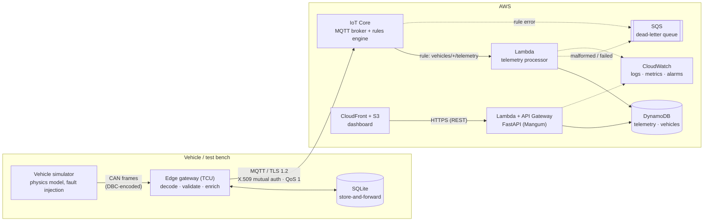

# Vehicle Telemetry IoT Platform

An end-to-end vehicle telemetry pipeline: simulated **CAN bus → edge gateway → MQTT → AWS IoT
Core → Lambda → DynamoDB → FastAPI → dashboard**, with infrastructure as code (AWS CDK),
monitoring, containers and CI.

It is a portfolio project that models a realistic telematics product: a vehicle (or test bench)
produces CAN signals, a gateway decodes and validates them and survives an unreliable cellular
link, and a cloud backend ingests, stores and serves the data.

- [Motivation](#motivation)
- [Architecture](#architecture)
- [Technology stack](#technology-stack)
- [Repository layout](#repository-layout)
- [Getting started](#getting-started)
- [MQTT topic structure](#mqtt-topic-structure)
- [Example messages](#example-messages)
- [API documentation](#api-documentation)
- [Testing](#testing)
- [Docker](#docker)
- [AWS deployment](#aws-deployment)
- [Monitoring and operations](#monitoring-and-operations)
- [Design decisions](#design-decisions)
- [Lessons learned](#lessons-learned)
- [Known limitations](#known-limitations)
- [Possible future improvements](#possible-future-improvements)

## Motivation

Connected-vehicle and test-fleet platforms share the same hard problems, and this project
exists to work through them end to end rather than in isolation:

- **Unreliable connectivity.** A vehicle drives through tunnels and dead zones. Data must be
  buffered on the device, survive a reboot, and arrive complete and in order later.
- **At-least-once delivery.** MQTT QoS 1 can duplicate messages. The cloud must be idempotent.
- **Trust at the edge.** Devices authenticate with X.509 certificates and may only touch their
  own topics. The cloud must not trust payload contents.
- **One contract, many components.** CAN layout, JSON schema and topics are defined once and
  shared, so gateway, Lambda and API cannot drift apart.
- **Operability.** Structured logs, custom metrics, alarms and a dead-letter queue turn "it
  works on my machine" into something that can be run.

## Architecture



**Data flow.**

1. The simulator runs a vehicle model (driving cycle, thermal model, battery, fuel, GPS) and
   emits **DBC-encoded CAN frames** on their real cycle times (100 ms / 1 s).
2. The gateway decodes frames, keeps the latest value per signal, and once per second builds one
   validated snapshot. Stale or missing signals suppress the snapshot instead of reporting wrong
   values. Every message is written to an on-disk queue and removed only after the broker
   acknowledged it.
3. IoT Core authenticates the device and an **IoT rule** hands the message to Lambda, adding the
   vehicle ID from the *topic* (`topic(2)`).
4. The Lambda validates, transforms and writes idempotently to DynamoDB. Malformed messages go
   to a dead-letter queue and are never retried; transient AWS errors are retried by Lambda.
5. A FastAPI service (the same code runs as a container or behind API Gateway) serves the data;
   a static dashboard visualises it.

Details, diagrams of failure modes and decision records: [docs/architecture.md](docs/architecture.md).

### Local equivalent

| Cloud component | Local stand-in (docker compose) |
|---|---|
| CAN bus | python-can `udp_multicast` between containers |
| AWS IoT Core | Eclipse Mosquitto |
| IoT rule → Lambda | `ingestor` container running **the same processor code** |
| DynamoDB | DynamoDB Local |
| API Gateway + Lambda | FastAPI under uvicorn |
| CloudFront + S3 | nginx |

## Technology stack

| Area | Technology |
|---|---|
| Language | Python 3.11+ (type hints, `mypy --strict`), JavaScript (no framework, no runtime dependencies) |
| Vehicle bus | CAN, DBC (`cantools`), `python-can` |
| Messaging | MQTT 3.1.1, QoS 1, `paho-mqtt` 2.x, Eclipse Mosquitto |
| Cloud | AWS IoT Core, Lambda (arm64), DynamoDB, SQS, API Gateway (HTTP API), CloudFront, S3, CloudWatch, SNS, X-Ray |
| API | FastAPI, Pydantic v2, Mangum, uvicorn |
| Infrastructure as code | AWS CDK (Python) |
| Containers | Docker (multi-stage, non-root), Docker Compose |
| Quality | pytest, moto, ruff, mypy, aws-cdk assertions, `node --test` |
| CI | GitHub Actions |

## Repository layout

```
packages/telemetry-common/        Shared contract: DBC, message schema, MQTT topics, DTC codec, logging
services/simulator/               Vehicle simulator (physics model → CAN frames)
services/edge_gateway/            Edge gateway (CAN → validated MQTT, store-and-forward)
cloud/lambdas/telemetry_processor/  Lambda (validate → transform → DynamoDB) + local MQTT bridge
services/api/                     FastAPI read API (container or Lambda)
dashboard/                        Static dashboard (vanilla JS, SVG charts and track plot)
infra/cdk/                        AWS CDK app, Lambda packaging script, template tests
docker/mosquitto/                 Local broker configuration
.github/workflows/ci.yml          CI pipeline
docs/                             Architecture, roadmap, interview notes
```

## Getting started

Requirements: Python 3.11+, Node.js 18+ (CDK tests and dashboard tests only), Docker (optional).

```bash
python -m venv .venv
source .venv/bin/activate          # Windows: .venv\Scripts\activate
pip install -r requirements-dev.txt

make check                         # lint + type check + tests   (or run the steps below)
pytest                             # Python tests
ruff check . && ruff format --check .
```

> **Windows:** keep the project in a short path (for example `C:\dev\vehicle-telemetry`).
> Python and pip fail on paths above 260 characters.

Watch a simulated drive without any infrastructure:

```bash
SIM_OUTPUT=stdout SIM_SEED=7 python -m vehicle_simulator     # one JSON snapshot per second
```

Configuration is read from environment variables only (`SIM_*`, `GW_*`, `API_*`, processor
variables). See [.env.example](.env.example) for every option. **No credentials are stored in code
or images.**

## MQTT topic structure

```
vehicles/{vehicle_id}/telemetry     device → cloud   QoS 1   periodic snapshot (1 Hz)
vehicles/{vehicle_id}/status        device → cloud   QoS 1   retained; online / offline (+ last will)
vehicles/{vehicle_id}/diagnostics   device → cloud   QoS 1   event: DTC set / cleared
vehicles/{vehicle_id}/commands      cloud → device   QoS 1   reserved for a back-channel (future)
```

- `vehicle_id` matches `[A-Za-z0-9_-]{3,64}`: it can never contain MQTT wildcards or `/`.
- Channels are separated by meaning and rate, so each has its own rule, retention and alarms.
- **Authorisation** uses IoT *policy variables*: a certificate attached to thing `gw-VH-0001` may
  connect only with that client ID and only publish to `vehicles/VH-0001/*`.
- The rule `SELECT *, topic(2) AS topic_vehicle_id FROM 'vehicles/+/telemetry'` passes the
  trustworthy topic ID to the Lambda, which rejects payloads claiming a different vehicle.

## Example messages

Telemetry (`vehicles/VH-0001/telemetry`), schema v1.0:

```json
{
  "schema_version": "1.0",
  "message_id": "8f6d1c1e-2a7b-4c59-9a3e-0f6c8f1d2b77",
  "vehicle_id": "VH-0001",
  "timestamp": "2026-11-10T09:15:02.100000+00:00",
  "speed": 87.42,
  "rpm": 2150.25,
  "coolant_temperature": 91.0,
  "battery_voltage": 14.112,
  "fuel_level": 63.2,
  "latitude": 49.0134123,
  "longitude": 12.1016456,
  "engine_status": "RUNNING",
  "diagnostic_code": null,
  "device": { "gateway_id": "gw-VH-0001", "firmware_version": "0.1.0", "sequence": 1532 }
}
```

Units: `speed` km/h · `rpm` 1/min · `coolant_temperature` °C · `battery_voltage` V · `fuel_level` % ·
WGS84 degrees. `sequence` increases per gateway; a gap in the cloud means a message was lost.

Diagnostic event (`vehicles/VH-0001/diagnostics`):

```json
{
  "schema_version": "1.0", "message_id": "…", "vehicle_id": "VH-0001",
  "timestamp": "2026-11-10T09:17:44.300000+00:00",
  "event": "DTC_SET", "diagnostic_code": "P0217",
  "device": { "gateway_id": "gw-VH-0001", "firmware_version": "0.1.0", "sequence": 1634 }
}
```

The CAN layout (frame IDs, scaling, cycle times) lives in
[vehicle.dbc](packages/telemetry-common/src/telemetry_common/data/vehicle.dbc).

## API documentation

With the Docker stack running the API is on `http://127.0.0.1:8080`; interactive OpenAPI docs are
served at `/docs`.

| Endpoint | Purpose |
|---|---|
| `GET /health` | Liveness probe (does not touch the database) |
| `GET /vehicles` | All vehicles: `online` flag, engine status, active DTC |
| `GET /vehicles/{vehicle_id}` | One vehicle including its latest snapshot |
| `GET /vehicles/{vehicle_id}/latest` | Latest telemetry snapshot |
| `GET /vehicles/{vehicle_id}/telemetry` | History, newest first by default |

`/telemetry` parameters: `start`, `end` (ISO 8601 **with timezone**, use `Z`; inclusive), `limit`
(1–1000, default 100), `order` (`desc`/`asc`), `cursor`.

```bash
curl http://127.0.0.1:8080/vehicles
curl http://127.0.0.1:8080/vehicles/VH-0001/latest
curl "http://127.0.0.1:8080/vehicles/VH-0001/telemetry?limit=5"
curl "http://127.0.0.1:8080/vehicles/VH-0001/telemetry?start=2026-11-10T09:00:00Z&end=2026-11-10T10:00:00Z&order=asc"
```

```json
{
  "vehicle_id": "VH-0001",
  "items": [ { "timestamp": "2026-11-10T09:15:02.100000Z", "speed": 87.42, "…": "…" } ],
  "next_cursor": "eyJ0cyI6MTc2Mjc2…"
}
```

Pass `next_cursor` as `cursor` for the next page; `null` means last page. The cursor is opaque
and cannot be used to read another vehicle's data.

| Status | Meaning |
|---|---|
| 400 | `start` after `end`, or invalid cursor |
| 404 | Unknown vehicle (a known vehicle with an empty window returns `200` and no items) |
| 422 | Invalid parameter (limit out of range, timestamp without timezone, bad vehicle ID) |
| 503 | Data store unavailable (no internals are leaked) |

Every response carries an `X-Request-ID` header, also written to the structured request log.

## Testing

```bash
pytest                              # all Python tests (needs Node.js for the CDK tests)
pytest --cov --cov-report=term-missing
node --test dashboard/tests/lib.test.mjs
```

**326 Python tests and 7 JavaScript tests, 94 % line coverage.** Without Docker or AWS:

| Layer | Approach |
|---|---|
| Vehicle model | Seeded RNG makes drives reproducible; physical limits, fault → DTC chain and debounce are asserted |
| CAN | Encode → decode round trips against the DBC; in-process virtual bus |
| Gateway | Fake transport and clock: offline buffering, ordering, retry/backoff, stale signals, DTC events |
| Lambda | [moto](https://github.com/getmoto/moto) fakes DynamoDB and SQS: duplicates, out-of-order replay, crash between two writes, broken DLQ, spoofing |
| API | In-memory repository over HTTP; the same behaviour against DynamoDB (moto); Lambda adapter with an API Gateway event |
| Infrastructure | CDK assertions on the synthesized template: least-privilege IAM, IoT policy variables, TTL, encryption, alarms, retention |
| Dashboard | Pure functions tested with Node's runner; checked manually in a browser against a live API |

Quality gates (all run in CI): `ruff check`, `ruff format --check`, `mypy --strict` on all source
packages.

## Docker

Requires Docker with Compose v2.

```bash
docker compose up --build -d     # broker, simulator, gateway, DynamoDB Local, ingestor, API, dashboard
docker compose logs -f gateway   # structured JSON logs
docker compose exec mosquitto mosquitto_sub -t 'vehicles/#' -v     # watch the MQTT traffic
docker compose down              # stop (the gateway buffer volume is kept)
```

| URL | Service |
|---|---|
| http://localhost:8081 | Dashboard |
| http://127.0.0.1:8080/docs | API (OpenAPI) |
| 127.0.0.1:1883 | Mosquitto (anonymous, local only) |
| 127.0.0.1:8000 | DynamoDB Local |

**Try the store-and-forward buffer:** `docker compose stop mosquitto`, wait 30 s, then
`docker compose start mosquitto`. The gateway logs `mqtt_disconnected`, keeps sampling into its
SQLite buffer, and delivers the backlog in order after the reconnect.

Images are multi-stage, run as a non-root user, and contain no credentials. Each Dockerfile is built
from the repository root, for example `docker build -f services/api/Dockerfile -t telemetry-api .`.

## AWS deployment

Prerequisites: an AWS account and CLI profile, Node.js 18+, Python 3.11+, `npm install -g aws-cdk`.

```bash
cd infra/cdk
pip install -r requirements.txt
python scripts/build_lambdas.py            # bundles for Lambda linux/arm64, no Docker needed
cdk bootstrap                              # once per account/region
cdk deploy -c environment=dev \
           -c vehicle_ids=VH-0001,VH-0002 \
           -c alarm_email=you@example.com
```

Context options: `environment` (`dev` destroys data with the stack, `prod` retains tables and
enables deletion protection), `vehicle_ids`, `alarm_email`, `telemetry_ttl_days` (default 30),
`alarm_on_missing_telemetry`, `api_cors_origins`. Outputs include `ApiUrl`, `DashboardUrl`,
`IngestDlqUrl` and `IotPolicyName`. Confirm the e-mail subscription sent by SNS.

**Provision a vehicle.** The stack creates the IoT thing and a shared policy but deliberately
**not** certificates or keys (a CloudFormation-generated key would be stored in template state).
Create them per device and keep them out of git:

```bash
mkdir -p certs && cd certs
aws iot create-keys-and-certificate --set-as-active \
  --certificate-pem-outfile device.pem.crt --private-key-outfile private.pem.key \
  --public-key-outfile public.pem.key --query certificateArn --output text   # prints the ARN
aws iot attach-policy --policy-name vtp-dev-vehicle-policy --target <certificateArn>
aws iot attach-thing-principal --thing-name gw-VH-0001 --principal <certificateArn>
curl -o AmazonRootCA1.pem https://www.amazontrust.com/repository/AmazonRootCA1.pem
aws iot describe-endpoint --endpoint-type iot:Data-ATS        # the broker host name
```

**Connect a gateway** (mount `certs/` read-only; the private key never enters an image):

```bash
GW_VEHICLE_ID=VH-0001 \
GW_MQTT_HOST=<endpoint from above> GW_MQTT_PORT=8883 GW_MQTT_TLS=true \
GW_MQTT_CA_FILE=certs/AmazonRootCA1.pem \
GW_MQTT_CERT_FILE=certs/device.pem.crt GW_MQTT_KEY_FILE=certs/private.pem.key \
python -m edge_gateway
```

Check the flow in the AWS console: IoT Core → MQTT test client (`vehicles/#`), the CloudWatch
dashboard `vtp-dev-overview`, the DynamoDB tables, then open `DashboardUrl`.
Tear down with `cdk destroy` (the `prod` data tables are retained on purpose).

> The stack has been **synthesized and tested** (34 infrastructure tests on the template, real Lambda bundles built),
> but not deployed to a real AWS account in this repository's development environment.

## Monitoring and operations

- **Logs.** Every component writes one JSON object per line (`timestamp, level, service, message,
  …context`). In CloudWatch Logs Insights:
  `fields @timestamp, vehicle_id, outcome | filter message = "telemetry_processed" | stats count() by outcome`
- **Metrics** (Embedded Metric Format, namespace `VehicleTelemetry`): `MessagesStored`,
  `DuplicateMessages`, `MalformedMessages`, `ProcessingLatencyMs`, and `IngestLagMs` (gateway
  sampling → stored, so it also shows buffering delay).
- **Alarms** (SNS): Lambda errors, DLQ not empty, many malformed messages, IoT rule failures,
  API 5xx, API Lambda errors, and no telemetry stored for 15 minutes.
- **Dashboard** `vtp-<env>-overview`: ingestion, lag, Lambda health, DLQ depth, API traffic.
- **Tracing.** Lambda X-Ray active tracing.
- **Dead-letter queue.** Inspect messages (reason + original payload), fix the cause, redrive.

## Design decisions

Full rationale in [docs/architecture.md](docs/architecture.md#11-key-design-decisions-short-adrs). In short:

- **DBC as the single source of truth** for the CAN layout (encode in the simulator, decode in the gateway).
- **Edge sampling** (10 Hz bus → 1 Hz cloud): ~90 % less traffic for a configurable loss of resolution.
- **At-least-once plus idempotency** instead of chasing exactly-once over MQTT.
- **SQLite store-and-forward**: survives outages and power loss with no extra infrastructure.
- **Malformed = permanent, infrastructure error = transient.** Different handling for each.
- **Two DynamoDB tables** (history + latest state) instead of single-table design: simpler to explain, matching the few known access patterns.
- **Same processing code locally and in AWS**, so the local stack tests real logic.
- **Least privilege by construction**: exact IAM actions per Lambda, per-device topic scoping with policy variables, no certificates in IaC.

## Lessons learned

- **Generate faults from physics, not from labels.** DTCs are derived from signal conditions with a
  debounce time, like a real ECU monitor. The tests exposed a modelling bug immediately: the
  voltage dip during engine cranking raised a low-voltage code until the battery recovery time was fixed.
- **Test the failure paths first.** Out-of-order replay, a crash between two writes, a broken
  dead-letter queue and a spoofed vehicle ID are each covered by a test. They are where real systems break.
- **Assertions on infrastructure find real bugs.** A test asserting "the processor may only
  `PutItem`" caught that CDK's convenient `grant_write_data` also grants `DeleteItem` and
  `BatchWriteItem`. The grants are now explicit.
- **Defaults hide production problems.** An empty `SIM_SEED=` (what Compose renders for an unset
  variable) crashed config parsing; empty environment variables now count as unset.
- **Framework details matter.** FastAPI cannot resolve annotations that reference run-time values
  when `from __future__ import annotations` is used, so `app.py` deliberately does without it.
- **Idempotency belongs in the data model.** Using the sampling time as the sort key makes a
  redelivered message hit the same item, so a conditional write is enough, no dedup table.
- **Verify what you can, and say what you couldn't.** The Docker images were written on a machine
  without Docker. Their input (a clean, non-editable install) was tested instead, and the gaps are listed below.

## Known limitations

- Not deployed to a real AWS account; Docker images and Compose stack not built/run on the
  development machine (CI builds the images).
- CAN over UDP multicast between containers depends on the Docker network; a gateway that logs
  `snapshot_unavailable` for every signal indicates this. Fallback: share one network namespace or use `vcan` on Linux.
- The API has no authentication (API Gateway throttling only). The local broker allows anonymous access.
- A message the broker permanently refuses would be retried forever (no attempt limit yet).
- Two different messages from one vehicle with the same millisecond timestamp would be treated as duplicates.
- The fleet list is a DynamoDB scan, capped at 1000 vehicles.
- Single region, no multi-account setup, no OTA or remote commands (the `commands` topic is reserved).

## Possible future improvements

- **Authentication** for the API (Cognito / JWT authorizer on API Gateway) and per-user vehicle access.
- **Back-channel**: signed remote commands over `vehicles/{id}/commands` with acknowledgement, for remote diagnostics.
- **E2E protection** (alive counter + CRC) on CAN frames, validated in the gateway like AUTOSAR E2E.
- **Fleet provisioning** by claim certificates instead of manual device certificates; IoT Device Shadow for configuration/OTA.
- **Long-term analytics**: Kinesis Firehose → S3 (Parquet) → Athena, or Timestream.
- **Attempt limit and quarantine** for poison messages in the gateway buffer.
- **Real CAN hardware** via SocketCAN, and UDS (ISO 14229) reads for VIN and stored DTCs.
- **Load test** and cost model for a 1000-vehicle fleet; DynamoDB GSI for the fleet list.
- **Blue/green deploys** of the Lambdas with CodeDeploy and alarms as rollback triggers.