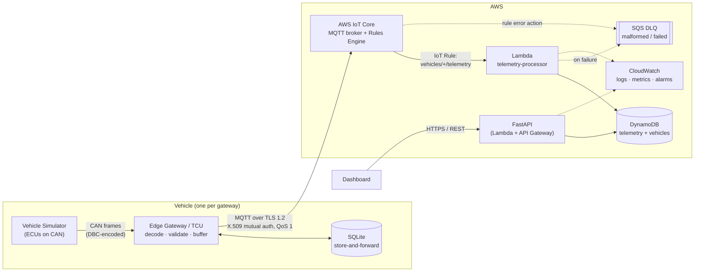

# Architecture — Vehicle Telemetry IoT Platform

This document describes the target architecture, the design decisions behind it and how each
component maps to a real automotive telemetry product. It is written so that every decision can be
defended in a technical interview: *what* was chosen, *why*, and *what the trade-off is*.

---

## 1. Use case

A fleet operator (e.g. a test-vehicle fleet at an engineering service provider) wants to:

* see where each vehicle is and whether it is healthy,
* get notified when a vehicle reports a diagnostic trouble code (DTC),
* keep a time series of signals (speed, RPM, coolant temperature, …) for later analysis.

Each vehicle carries a **telematics control unit (TCU)** — here called the *edge gateway* — that
listens to the vehicle CAN bus, decodes the frames, and forwards structured telemetry to the cloud
over a cellular link that is *not* always available.

---

## 2. End-to-end data flow



### Local development equivalent (Docker Compose)

| Cloud component     | Local stand-in                                          |
|---------------------|---------------------------------------------------------|
| CAN bus             | python-can `udp_multicast` virtual bus between containers |
| AWS IoT Core        | Eclipse Mosquitto                                       |
| IoT Rule → Lambda   | `local-ingestor` container: subscribes to Mosquitto and calls the **same** Lambda handler |
| DynamoDB            | DynamoDB Local                                          |
| API Gateway + Lambda| FastAPI under Uvicorn                                   |

The key point: business logic (decoding, validation, transformation, persistence) is identical
locally and in AWS. Only the transport adapters differ.

---

## 3. Components

### 3.1 Vehicle simulator (`services/simulator`)
* Physics-inspired model: driving cycle state machine (parked → idle → accelerate → cruise →
  decelerate), gear-based RPM, first-order thermal model for coolant, alternator/battery model,
  fuel consumption, GNSS dead-reckoning starting in Regensburg.
* Fault injection as a Poisson process (overheat, alternator failure, misfire). DTCs are **not**
  injected directly — they are *derived* from signal conditions with a maturation (debounce) time,
  the same way an ECU's diagnostic monitor works.
* Encodes signals into CAN frames using a **DBC file** (`cantools`) and sends each frame with the
  cycle time declared in the DBC (`GenMsgCycleTime`).

### 3.2 Edge gateway (`services/edge_gateway`)
* Receives CAN frames, decodes them with the same DBC.
* Maintains a **signal cache** (latest value + age per signal) and samples a snapshot at a fixed
  publish rate (1 Hz) → bandwidth and cost control instead of forwarding every 10 ms frame.
* Rejects stale signals, validates the snapshot against the shared Pydantic schema.
* Adds `timestamp`, `message_id` (UUID), sequence number and device metadata.
* Publishes via MQTT (QoS 1) with exponential-backoff reconnect.
* **Store-and-forward**: every message is first written to an on-disk SQLite queue and only deleted
  after the broker acknowledges it (PUBACK). Survives network outages *and* gateway restarts.
* Last Will and Testament on `vehicles/{id}/status` so the cloud knows when a vehicle drops offline.

### 3.3 AWS IoT Core
* One IoT *Thing* per vehicle, one X.509 certificate per Thing.
* IoT policy scoped with `${iot:Connection.Thing.ThingName}` — a vehicle can only connect with its
  own client ID and only publish to its own topic subtree.
* IoT Rule `SELECT *, topic(2) AS topic_vehicle_id FROM 'vehicles/+/telemetry'` → Lambda, with an
  error action to SQS.

### 3.4 Lambda `telemetry-processor` (`cloud/lambdas/telemetry_processor`)
* Validates the payload against the shared schema; malformed messages are logged with reason and
  sent to the DLQ — they never crash the function or block the stream.
* Cross-checks topic vehicle ID vs. payload vehicle ID (spoofing guard).
* Transforms into the DynamoDB item format (Decimal conversion, TTL, keys).
* **Idempotent write** (conditional `attribute_not_exists`) because MQTT QoS 1 is
  *at-least-once* — duplicates after a reconnect are expected and harmless.
* Updates the `vehicles` table with the latest snapshot only if the message is newer
  (out-of-order replay from the gateway buffer must not overwrite fresher data).

### 3.5 FastAPI service (`services/api`)
`GET /health`, `GET /vehicles`, `GET /vehicles/{id}`, `GET /vehicles/{id}/telemetry`
(time range + pagination), `GET /vehicles/{id}/latest`. Repository pattern so the DynamoDB
implementation can be swapped with an in-memory one in tests.

### 3.6 Dashboard (`dashboard/`)
Lightweight static page (map + charts) consuming the REST API — the focus of this project is the
platform, not frontend engineering.

---

## 4. MQTT topic design

```
vehicles/{vehicle_id}/telemetry     device → cloud   QoS 1   1 Hz periodic snapshot
vehicles/{vehicle_id}/status        device → cloud   QoS 1   retained; online/offline (+ LWT)
vehicles/{vehicle_id}/diagnostics   device → cloud   QoS 1   event: DTC set / cleared
vehicles/{vehicle_id}/commands      cloud → device   QoS 1   back-channel (future: remote diagnostics)
```

Rationale:
* `vehicle_id` at level 2 → wildcard subscriptions per channel (`vehicles/+/telemetry`) and
  per-vehicle authorization with a single policy variable.
* Channels separated by *semantics and rate*, so each can have its own IoT Rule, retention and
  alarms (diagnostics are rare and important; telemetry is frequent and bulk).
* No leading `/`, no PII in topics, IDs restricted to `[A-Za-z0-9_-]` (no MQTT wildcards possible).

---

## 5. Telemetry message contract (schema v1.0)

```json
{
  "schema_version": "1.0",
  "message_id": "8f6d1c1e-2a7b-4c59-9a3e-0f6c8f1d2b77",
  "vehicle_id": "VH-0001",
  "timestamp": "2026-11-10T09:15:02.100000+00:00",
  "speed": 87.42,
  "rpm": 2150.25,
  "coolant_temperature": 91.0,
  "battery_voltage": 14.112,
  "fuel_level": 63.2,
  "latitude": 49.0134123,
  "longitude": 12.1016456,
  "engine_status": "RUNNING",
  "diagnostic_code": null,
  "device": {
    "gateway_id": "gw-VH-0001",
    "firmware_version": "0.1.0",
    "sequence": 1532
  }
}
```

Units: `speed` km/h · `rpm` 1/min · `coolant_temperature` °C · `battery_voltage` V ·
`fuel_level` % · `latitude/longitude` WGS84 degrees · `timestamp` ISO 8601 UTC.

The contract lives in **one** place (`packages/telemetry-common`) and is imported by the gateway,
the Lambda and the API. `schema_version` allows non-breaking evolution.

---

## 6. CAN layer (DBC)

`packages/telemetry-common/src/telemetry_common/data/vehicle.dbc`

| ID    | Message               | Cycle  | Signals |
|-------|-----------------------|--------|---------|
| 0x100 | EngineData            | 100 ms | EngineSpeed (0.25 rpm/bit), CoolantTemperature (offset −40), EngineStatus |
| 0x200 | VehicleDynamics       | 100 ms | VehicleSpeed (0.01 km/h/bit), FuelLevel (0.4 %/bit) |
| 0x300 | BatteryStatus         | 1000 ms| BatteryVoltage (1 mV/bit) |
| 0x400 | GnssPosition          | 1000 ms| Latitude, Longitude (signed, 1e-7 °/bit) |
| 0x500 | DiagnosticTroubleCode | 1000 ms| DtcActive, DtcCategory (P/C/B/U), DtcCode (16 bit) |

The vehicle ID is **not** on the bus (as in a real vehicle, where the VIN is read via UDS once).
The gateway owns the identity through its configuration / certificate.

---

## 7. DynamoDB data model

**`telemetry` table** — time series
| Attribute | Key | Notes |
|---|---|---|
| `vehicle_id` | PK | |
| `ts` | SK | epoch milliseconds (Number) → range queries |
| `message_id` | | dedup / traceability |
| `expires_at` | TTL | default 30 days retention |

**`vehicles` table** — current state per vehicle (`vehicle_id` PK, latest snapshot, `last_seen`,
`active_dtc`). `GET /vehicles` is a small scan here, not over the time series.

Access patterns: latest state (GetItem), history in time range (Query PK + SK BETWEEN, newest
first, paginated with `LastEvaluatedKey`), fleet list (Scan of small table).
On-demand capacity: unpredictable fleet traffic, no capacity planning in a demo.

---

## 8. Reliability & failure modes

| Failure | Behaviour |
|---|---|
| Cellular link down | Gateway keeps sampling into SQLite buffer (bounded, oldest dropped first with a metric) |
| Gateway restart | Buffer is on disk → no data loss for acknowledged-to-disk messages |
| Duplicate delivery (QoS 1) | Idempotent conditional write in Lambda |
| Out-of-order replay | Latest-state update guarded by `ts` condition |
| Malformed payload | Rejected, logged with reason, sent to DLQ, metric `MalformedMessages` |
| Lambda error / throttling | IoT Rule error action → SQS DLQ; CloudWatch alarm |
| CAN frame missing | Signal marked stale after timeout; snapshot not published with stale data |

---

## 9. Security

* No secrets in code or images; everything via environment variables / mounted files.
* Device auth: X.509 mutual TLS; certificates mounted at runtime, never baked into images.
* Least-privilege IAM per Lambda (write-only for processor, read-only for API).
* Containers run as non-root.
* Encryption at rest (DynamoDB default KMS) and in transit (TLS 1.2).

---

## 10. Observability

* **Structured JSON logs** in every component (one schema: `timestamp, level, service, message, …`)
  → directly queryable with CloudWatch Logs Insights.
* Custom metrics (Embedded Metric Format): `MessagesProcessed`, `MalformedMessages`,
  `DuplicateMessages`, `ProcessingLatencyMs`.
* Alarms: Lambda errors, DLQ depth > 0, no telemetry from fleet for N minutes.
* CloudWatch dashboard defined in CDK.

---

## 11. Key design decisions (short ADRs)

1. **DBC as single source of truth** for CAN layout — industry standard, toolable (CANalyzer,
   cantools), no hand-written bit fiddling.
2. **Sampling at the edge (10 Hz bus → 1 Hz cloud)** — trade-off: lower resolution vs. ~90 % less
   traffic and cost. Configurable per deployment.
3. **At-least-once + idempotency** instead of trying to achieve exactly-once over MQTT.
4. **SQLite store-and-forward** instead of in-memory queue — survives power loss, zero extra
   infrastructure, well understood on embedded Linux.
5. **Same handler locally and in Lambda** — the local stack tests real business logic.
6. **Two DynamoDB tables** instead of single-table design — slightly more resources, much easier to
   read and explain; access patterns are few and known.
7. **FastAPI on Lambda (Mangum) behind API Gateway** — pay-per-request for a low-traffic API;
   the same app runs in a container if traffic grows (ECS Fargate).
